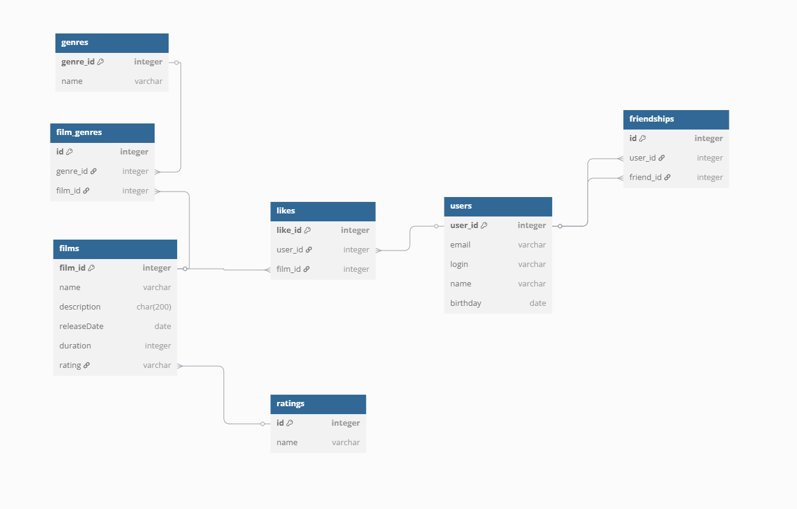

# Filmorate

---

Это сервис, который работает с фильмами и оценками пользователей, а также возвращает топ-5 фильмов, рекомендованных к просмотру.
Проект делался в учебных целях на Framework Spring Boot, с применением Maven, Lombok, а так же подключением базы данных  H2 



### Технологический стек

---
* Backend: Java, Spring Boot

* База данных: H2 

* Сборка: Maven

* Тестирование: JUnit

### Предварительные требования

---
* JDK 11 или выше

* Maven (опционально, так как используется Maven Wrapper mvnw)

* Git

### Построение и запуск проекта

---
Скопируйте проект на ваш компьютер с помощью Git:
```bash
git clone https://github.com/Zizann86/java-filmorate.git
```
Перейдите в корневую директорию проекта:
```bash
cd java-filmorate
```
### Сборка проекта

---
```bash
# Для Linux/macOS:
./mvnw clean install

# Для Windows (в командной строке CMD или PowerShell):
./mvnw.cmd clean install
```
### Запуск приложения

---
```bash
# Для Linux/macOS:
./mvnw spring-boot:run

# Для Windows (в командной строке CMD или PowerShell):
./mvnw.cmd spring-boot:run
```
Приложение будет запущено на порту 8080.